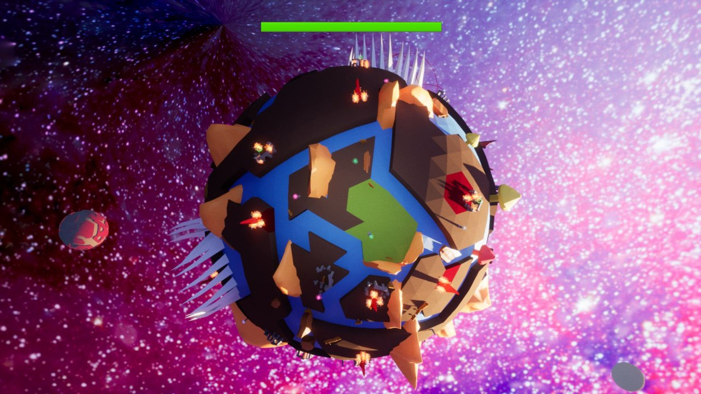
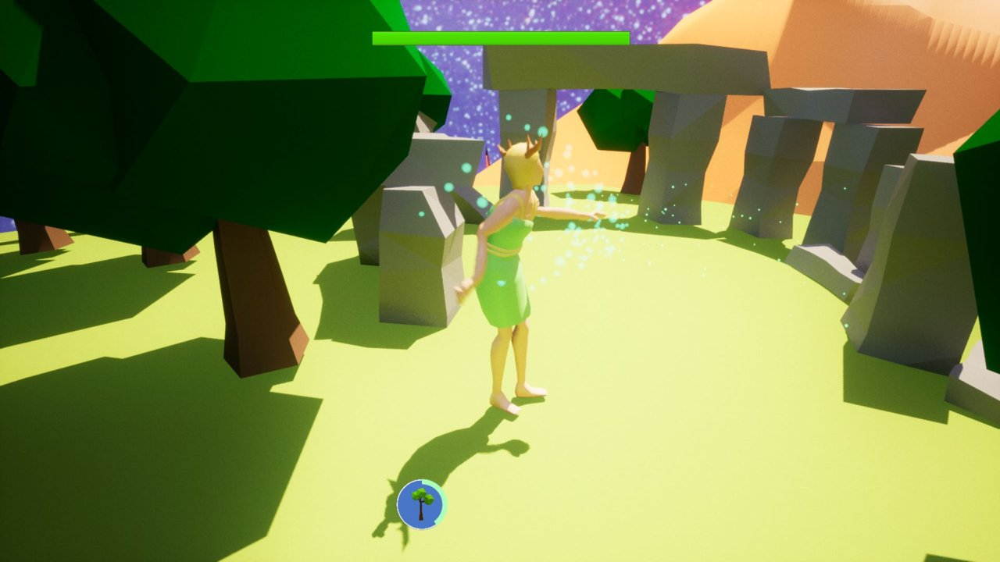
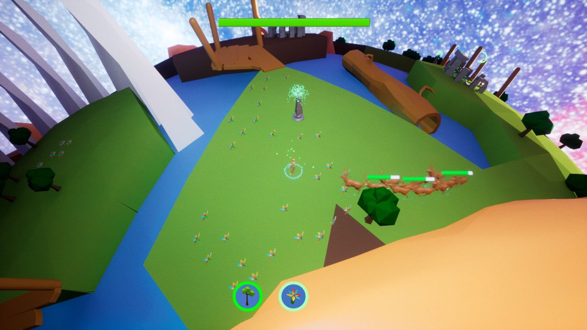
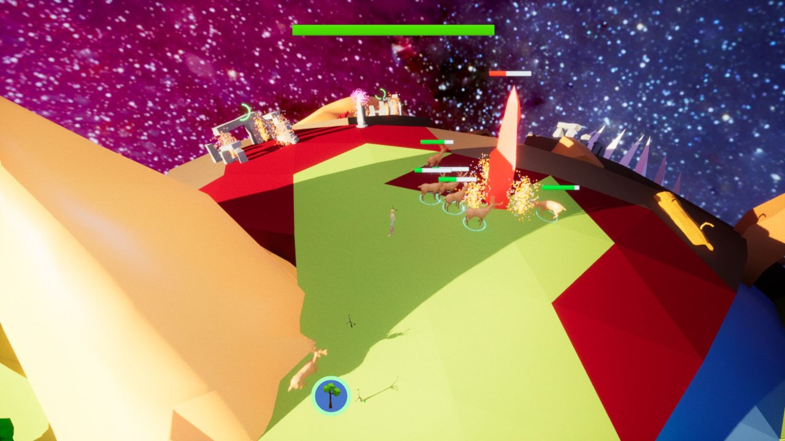
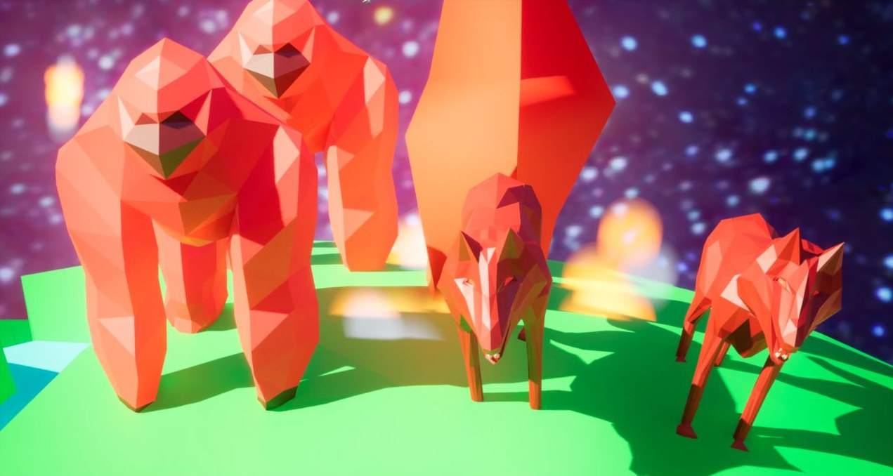

# 🌍 Mother Earth

**A third-person nature goddess game with RTS elements, set on a tiny spherical planet. Built in Unreal Engine 5.**

*Mother Earth* puts you in the role of a nature goddess on a scorched, barren planet. Walk all the way around the globe, cast spells to grow trees, flowers, and carnivorous plants, and turn the world green again. Fire creatures are trying to burn it all back down, so you rally deer to your side and command them RTS-style against wolves, gorillas, and finally a dragon.

The game was made by a 6-person team in a semester-long Traditional Game Development course at the University of Utah. Each student pitched a game, and *Mother Earth*, pitched by Cam Knight, was one of the pitches chosen for production. It was the whole team's first 3D game project and first time using Unreal.

   
  <i>The whole game takes place on one small, scorched planet</i>

> **About this repo:** this is the full development repository: the Unreal Engine 5 project, C++ source, and Blueprints. The [`Wrap Kit/`](Wrap%20Kit/) folder holds the original pitch document and a set of gameplay screenshots.

---

## Features

- **Walk around a whole planet:** a third-person character and camera that work on a sphere, with no "up" that stays the same
- **Regrow the world:** cast spells toward the cursor to grow trees, flowers, and spitting carnivorous plants
- **Command nature minions:** drag-select, shift-select, and send deer to fight, RTS-style, or have them follow you
- **Fight back the fire:** waves of wolves and gorillas pour out of stone circles, ending in a dragon boss
- **A living map:** every tile of the planet changes color as it's healed or scorched
- **Puzzle-gated regions:** grow enough plant life to activate pillars, raise bridges, and move mountains to reach new areas
- **Meteor showers and tutorial signs written as haikus,**

   
  <i>The goddess growing trees near an enemy stone circle</i>

## How it works

### 🌐 A planet made of tiles

The planet is built from **2,400+ individual tiles**: 1,348 land and 1,071 water. A C++ spawner (`AWorldTileSpawner`) creates every tile at runtime from its mesh asset and gives each one its own state, such as whether grass or trees can grow there. Each tile tracks its own health and colors itself to match, from scorched red through to healthy green. Tiles are grouped into **regions** that the game uses to check progress. Water tiles are deadly to ground units.

### 🌱 Spells & plant life

Spells are cast toward the mouse cursor raycast from the camera to the surface of the planet. The player can switch between which spell they're casting. Trees grow over time and heal the ground around them, preventing them from turning red. Flowers have to be planted on healthy soil, or they burn up on scorched tiles. Carnivorous plants act as stationary turrets that spit at nearby enemies. Each region has its own plant-life requirement, which ties regrowing the world directly into progressing through it.

### 🦌 Minions & enemies

Allied deer and enemy creatures run on Unreal behavior trees and AI perception. Players control minions with classic RTS input: drag a box to select, shift-click to add, and click to move or attack. Minions can also be told to follow the goddess. Enemies spawn from stone circles and crystals in waves, with a cap on how many each circle can have at once. They target the player, minions, and trees.

### 🌉 Progression

The planet is split into regions that open up one at a time. Growing grass and plants activates **pillars**, which raise **bridges**. Destroying an enemy's **crystal** makes the mountains blocking the way shift, with a camera transition that shows the change. The final region holds the dragon.

   
  <i>Commanding deer across a half-healed region, with the spell bar at the bottom</i>

## Challenges

Building a third-person game on a sphere meant that many things Unreal normally handles for free had to be solved by hand:

- **Player movement and gravity.** "Down" is always toward the planet's center, so the character's orientation has to be recalculated continuously as it walks.
- **The camera.** A standard third-person camera rig assumes a fixed up direction. Here the camera has to follow the curve of the planet without flipping, clipping into terrain, or losing the angle during scripted transitions.
- **NPC navigation.** Pathfinding meshes are built for mostly flat ground. Getting minions and enemies to path, target, and avoid crowding each other around a curved surface took custom trace channels, collision tuning, and many playtest iterations.
- **Performance.** Thousands of tiles, plants, and AI units at once called for load distances and efficiency passes late in development.

<table>
  <tr>
    <td width="50%"></td>
    <td width="50%"></td>
  </tr>
  <tr>
    <td align="center"><i>Pushing into scorched territory</i></td>
    <td align="center"><i>The fire horde: gorillas and wolves</i></td>
  </tr>
</table>

## Tech

| | |
|---|---|
| **Engine** | Unreal Engine 5.0 |
| **Languages** | C++, Blueprints |
| **AI** | Behavior trees, AI perception |
| **Platform** | PC (Windows) |
| **Development** | Spring 2023 · University of Utah, Traditional Game Development |

## Running the project

1. Install **Unreal Engine 5.0** and Visual Studio with C++ game development tools.
2. Clone this repo. The project is large (over 1 GB).
3. Open `UnrealTestCPPProject/TestProject/TestProject.uproject`. If Unreal asks to build the C++ modules, choose **Yes**.

## Team

| Name | Role |
|---|---|
| **Cam Knight** | Group lead, programmer |
| **Benjamin Rose** | Programmer |
| **Binghe Yi** | Music, animations |
| **Alan Liu** | Level design |
| **Kelin Wen** | Modeling, animations |
| **Zhengbiao Ye** | Modeling |
